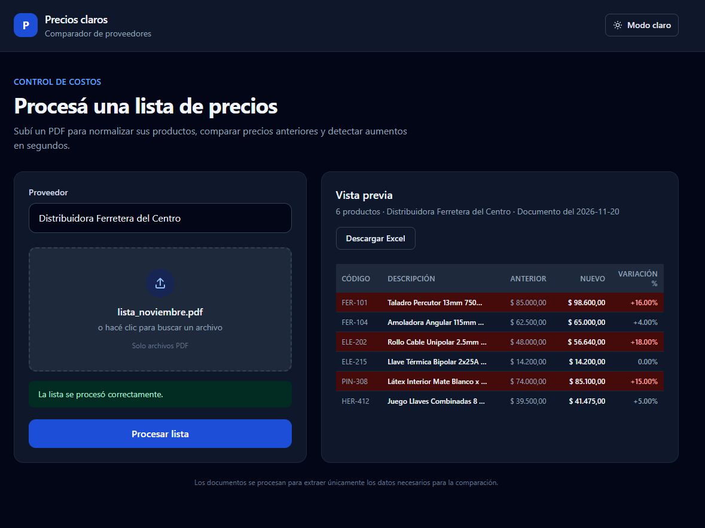
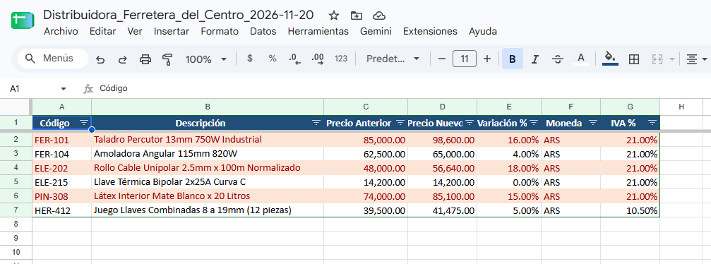
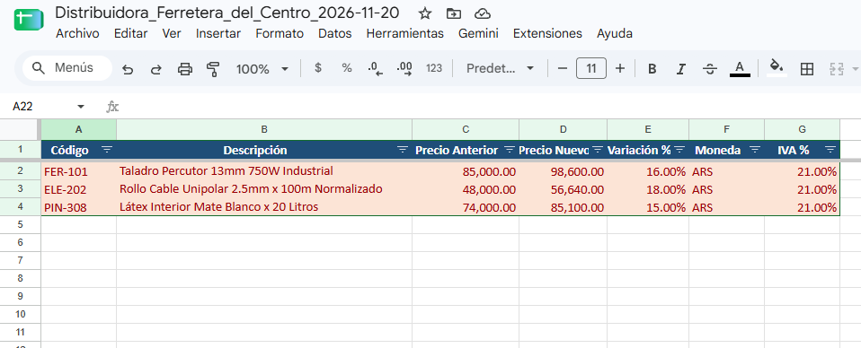

# Procesador de proveedores

MVP local para extraer productos de listas de precios PDF, comparar sus valores
con cargas anteriores y descargar el resultado en Excel. La extracción usa
Gemini; requiere una clave de API propia.

## Vista previa

### Interfaz web y detección de aumentos (>10 %)


### Excel generado — Lista normalizada


### Excel generado — Alertas de aumento


## Puesta en marcha

1. Usá Python 3.10 o superior y creá un entorno virtual dentro del proyecto.
2. Instalá las dependencias:

   ```powershell
   .\.venv\Scripts\Activate.ps1
   pip install -r backend\requirements.txt